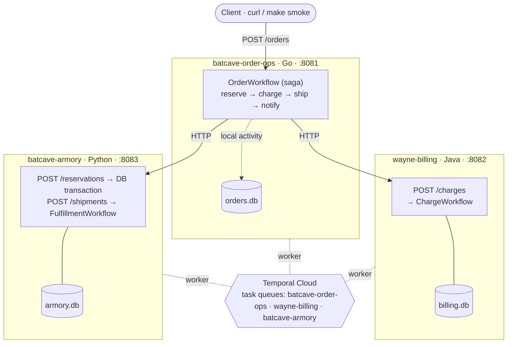
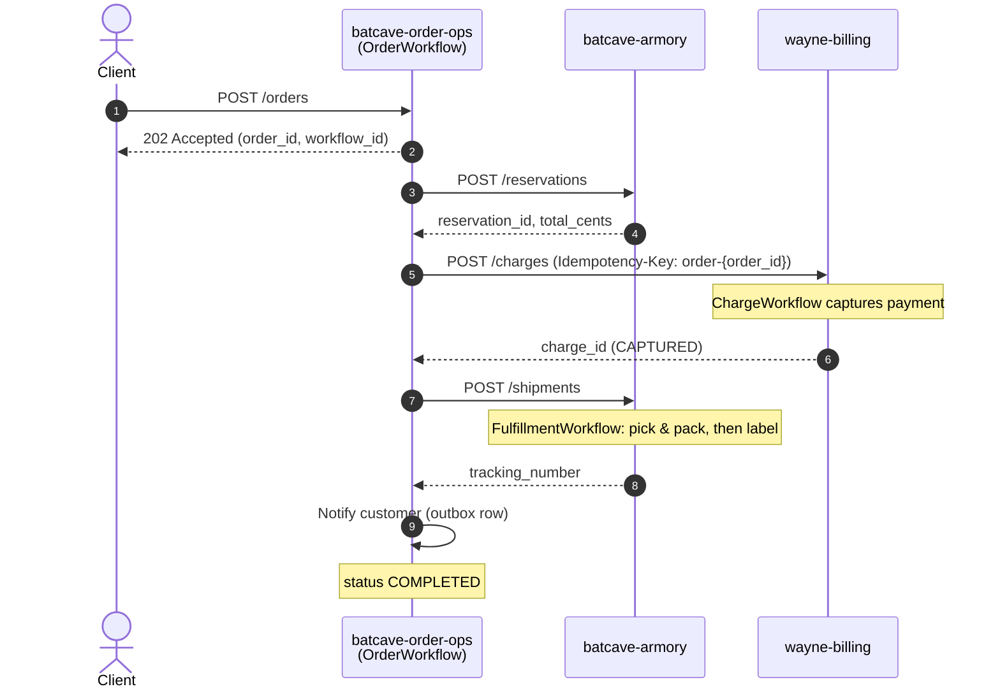

# Gotham Supply Co.

> [!NOTE]
> **Fan-made, non-commercial learning project.** Not affiliated with, endorsed by, or connected to DC, Warner Bros. Discovery, or any rights holder. Batman-related names are used only as playful theming; nothing here is for sale.

An order fulfillment platform for an imaginary Gotham collectibles shop. It is built as independent microservices, each with its own REST API, SQLite database, and [Temporal](https://temporal.io) worker.

The goal is to learn Temporal the way it usually shows up in practice: added to services that already talk to each other over HTTP, rather than living inside a single-process demo.

## Architecture



| Service | Language | Port | Responsibility | Temporal pieces |
|---|---|---|---|---|
| [`batcave-order-ops`](services/batcave-order-ops) | Go | 8081 | Order intake and orchestration | `OrderWorkflow`: the saga |
| [`wayne-billing`](services/wayne-billing) | Java | 8082 | Payments, billed as "Wayne Enterprises" | `ChargeWorkflow` behind `POST /charges` |
| [`batcave-armory`](services/batcave-armory) | Python | 8083 | Catalog, per-warehouse stock, fulfillment | `FulfillmentWorkflow` behind `POST /shipments` |
| `alfred` *(planned)* | TypeScript | 8084 | Customer-support agent | Agentic loop, human escalation via signal |

Each service runs its REST API and its Temporal worker in one process, and polls its own task queue.

## How an order flows



As the workflow progresses, it records each order status in `orders.db`:

`RECEIVED` → `RESERVING_INVENTORY` → `CHARGING_PAYMENT` → `SHIPPING` → `NOTIFYING_CUSTOMER` → `COMPLETED`

Any step can end in `FAILED` instead. Phase 1 has no compensation yet, so a failure after the reservation step leaves stock held. Compensation is the first item in [Phase 2](docs/ROADMAP.md#phase-2-deepen-batcave-order-ops-go).

## Quick start

### Prerequisites

| Tool | Version | Used by |
|---|---|---|
| Go | 1.26+ | `batcave-order-ops` |
| Java + Maven | JDK 21+, Maven 3.9+ | `wayne-billing` |
| Python + [uv](https://docs.astral.sh/uv/) | Python 3.13+ | `batcave-armory` |
| [Temporal CLI](https://docs.temporal.io/cli) | latest | inspecting workflows; local dev server (optional) |
| `curl`, `python3` | any | `scripts/` |
| `jq` | any | optional, for the examples below |

### Configure Temporal

Every service connects through its SDK's **envconfig** loader. The same settings therefore work in Go, Java, and Python.

```bash
cp .env.example .env    # then fill in your values
```

| Setup | Set these |
|---|---|
| Temporal Cloud with an API key | `TEMPORAL_ADDRESS`, `TEMPORAL_NAMESPACE`, `TEMPORAL_API_KEY` |
| Temporal Cloud with mTLS | `TEMPORAL_ADDRESS`, `TEMPORAL_NAMESPACE`, `TEMPORAL_TLS_CLIENT_CERT_PATH`, `TEMPORAL_TLS_CLIENT_KEY_PATH` |
| A profile in `~/.config/temporalio/temporal.toml` | `TEMPORAL_PROFILE` |
| Local dev server | nothing: run `temporal server start-dev` and every service falls back to `localhost:7233`, namespace `default` |

> [!IMPORTANT]
> `scripts/dev.sh` loads `.env` without overriding variables already exported in your shell. If your shell profile already sets `TEMPORAL_*`, those values win.

### Run

```bash
make up       # build and start all services; logs in .logs/<service>.log
make status   # health-check each service
make smoke    # place an order and follow it to COMPLETED
make down     # stop everything
```

| Command | What it does |
|---|---|
| `make up` / `make down` / `make status` | Start, stop, or health-check all services via `scripts/dev.sh` |
| `make smoke` | End-to-end happy path (`scripts/smoke.sh`) |
| `make build` | Build all three services without starting them |
| `make check-determinism` | Run Temporal's `workflowcheck` static analyzer on the Go workflows |
| `make clean` | Delete local SQLite data, logs, and PID files |
| `scripts/dev.sh logs <service>` | Tail one service's log |

## Try it by hand

```bash
# Browse the catalog and stock
curl -s localhost:8083/products  | jq
curl -s localhost:8083/inventory | jq

# Place an order
curl -s -X POST localhost:8081/orders -H 'Content-Type: application/json' -d '{
  "customer_id": "selina-kyle",
  "items": [{"sku": "BAT-004", "quantity": 1}],
  "shipping_address": {"name": "Selina Kyle", "street": "1 Rooftop Way", "city": "Gotham", "country": "US"}
}' | jq

# Follow it
curl -s localhost:8081/orders/<order_id> | jq
temporal workflow show -w order-<order_id>       # the full event history
```

## Break it on purpose

These exercises show what Temporal is actually doing for you.

**1. Take billing down in the middle of an order.** The order waits in `CHARGING_PAYMENT` while `ChargePayment` retries with exponential backoff. Bring billing back and the order completes on its own.

```bash
kill "$(cat .run/wayne-billing.pid)"
make smoke &                                     # order stalls in CHARGING_PAYMENT
temporal workflow describe -w order-<order_id>   # Pending Activities: attempt count and last failure
make up                                          # billing returns; the order completes
```

**2. Order more than exists.** `BAT-003` (Cowl Display Bust) has only 2 units in stock. The armory replies `409 OUT_OF_STOCK`. The activity turns that into a *non-retryable* `ApplicationError`, so the order fails immediately instead of retrying.

```bash
curl -s -X POST localhost:8081/orders -H 'Content-Type: application/json' \
  -d '{"customer_id": "oswald-cobblepot", "items": [{"sku": "BAT-003", "quantity": 5}]}'
```

**3. Submit the same order twice.** If you supply `order_id` yourself, it becomes the workflow ID (`order-<order_id>`). The second submit is rejected with `409 ORDER_EXISTS`, even after the first run has finished.

```bash
for i in 1 2; do curl -s -X POST localhost:8081/orders -H 'Content-Type: application/json' \
  -d '{"order_id": "GSC-DUPE-1", "customer_id": "harvey-dent", "items": [{"sku": "RGS-201", "quantity": 1}]}'; echo; done
```

**4. Replay a charge.** Sending the same `Idempotency-Key` returns the original charge. Sending the same key with a different amount is rejected with `422 IDEMPOTENCY_KEY_REUSED`.

```bash
curl -s -X POST localhost:8082/charges -H 'Content-Type: application/json' -H 'Idempotency-Key: demo-1' \
  -d '{"order_id": "demo-1", "customer_id": "lucius-fox", "amount_cents": 4999}'   # run twice: same charge_id
curl -s -X POST localhost:8082/charges -H 'Content-Type: application/json' -H 'Idempotency-Key: demo-1' \
  -d '{"order_id": "demo-1", "customer_id": "lucius-fox", "amount_cents": 1}'      # 422
```

## API reference

| Service | Endpoint | Notes |
|---|---|---|
| order-ops `:8081` | `POST /orders` | Starts `OrderWorkflow` and returns `202`. `order_id` is optional; it is generated if omitted |
| | `GET /orders`, `GET /orders/{id}` | Read from `orders.db` |
| billing `:8082` | `POST /charges` | Requires an `Idempotency-Key` header. Waits up to 20s for `ChargeWorkflow` |
| | `GET /charges`, `GET /charges/{id}` | |
| armory `:8083` | `GET /products`, `GET /inventory` | Catalog and per-warehouse `on_hand` / `reserved` / `available` |
| | `POST /reservations`, `GET /reservations/{id}` | Atomic, all-or-nothing hold; idempotent on `order_id` |
| | `POST /shipments`, `GET /shipments/{order_id}` | `POST` waits up to 20s for `FulfillmentWorkflow`; idempotent on `order_id` |
| all | `GET /healthz` | |

## Design notes

**Cross-service calls are real HTTP.** The order saga's activities call the other services' public REST APIs. They don't use child workflows or shared task queues. Each service is a black box with its own database, which is how Temporal usually meets an existing system.

**One error contract.** Errors are returned as `{"error": "<CODE>", "message": "..."}`. The caller in order-ops (`postJSON` in [activities.go](services/batcave-order-ops/internal/activities/activities.go)) classifies them:

| Response | Becomes | Retried? |
|---|---|---|
| Network error, 5xx, 408, 429 | `ApplicationError` | Yes, with backoff |
| Any other 4xx | Non-retryable `ApplicationError` with `Type` = the remote code, e.g. `OUT_OF_STOCK` | No |

Having the remote code as the error `Type` lets the workflow branch on it. If a 4xx body has no code, the type falls back to `HTTP_<status>`.

**Idempotency comes from business IDs, at every layer.** Activities are retried, so every write they trigger must be safe to repeat.

| Layer | Mechanism |
|---|---|
| Order workflow | Workflow ID `order-<order_id>` with reuse policy `REJECT_DUPLICATE` |
| Billing | `Idempotency-Key: order-<order_id>` maps to workflow ID `charge-<key>`.<br/>Conflict policy `USE_EXISTING`: a concurrent duplicate attaches to the running charge.<br/>Reuse policy `ALLOW_DUPLICATE_FAILED_ONLY`: a failed run may be retried, a completed charge is final.<br/>Backed by `UNIQUE(idempotency_key)` in the database. |
| Armory | Reservations and shipments are `UNIQUE(order_id)`; fulfillment runs as workflow `fulfill-<order_id>` |

**Synchronous HTTP facades over workflows.** `POST /charges` and `POST /shipments` start a workflow and wait up to 20s for its result. The timeouts are nested so that the inner one always fires first:

1. The service waits at most 20s for the workflow.
2. The order-ops HTTP client times out at 25s.
3. The calling activity's `StartToClose` timeout is 30s.

If the workflow takes longer than 20s, the service returns `504 *_IN_PROGRESS`. The activity then retries with the same key, and that retry attaches to the same workflow execution.

**Local activities for local writes.** `OrderWorkflow` writes status changes to its own database as *local* activities. These skip the task-queue round trip and appear in the event history as `MarkerRecorded` events.

## Gotchas log

Things that bit us along the way. They're worth knowing before a customer hits them.

- **Go SDK: `ExecuteWorkflow` silently returns the existing run.** By default, starting a workflow whose ID already exists returns a handle to the existing run instead of an error, even with `REJECT_DUPLICATE`. Set `WorkflowExecutionErrorWhenAlreadyStarted: true` to get `WorkflowExecutionAlreadyStarted`. See [api.go](services/batcave-order-ops/internal/api/api.go).

## Repository layout

```
.
├── Makefile                  make up / down / status / smoke / build / clean
├── .env.example              Temporal connection template (copy to .env)
├── docs/ROADMAP.md           phased plan and the Temporal concepts in each phase
├── scripts/
│   ├── dev.sh                start / stop / status / logs for all services
│   └── smoke.sh              end-to-end happy path
└── services/
    ├── batcave-order-ops/    Go      cmd/server, internal/{workflows,activities,api,store,shared}
    ├── wayne-billing/        Java    com.gotham.billing.{workflow,activities,api,db,model}
    └── batcave-armory/       Python  src/batcave_armory/{workflows,activities,api,db,models}.py
```

## Roadmap

Phase 1, the vertical slice, is complete. Next up are saga compensation, signals, queries, updates, and versioning in `batcave-order-ops`. See [docs/ROADMAP.md](docs/ROADMAP.md).

## Credits

| | |
|---|---|
| 🦇 **The Dark Knight** | **Pravin Bhat** ([@pravinbhat](https://github.com/pravinbhat)): architecture, direction, and every "but what happens when billing goes down?" |
| 🔧 **Lucius Fox, Applied Sciences** | **[Claude](https://claude.com/claude-code)** (Anthropic), pair programmer via Claude Code: built the gadgets, tested them on Temporal Cloud, and logged the ones that misfired |

> *"I took the liberty of making the payments idempotent, Mr. Wayne. Retries happen."*

---

<sub>Gotham Supply Co. is an unofficial, fan-made educational project. All character and place names belong to their respective owners and are used here without any commercial intent.</sub>
